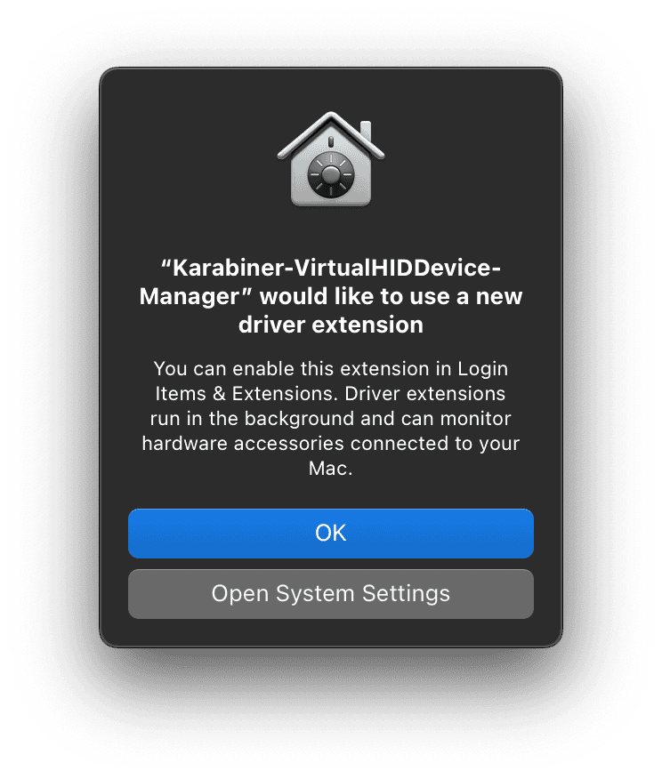

# kanata-darwin

Declarative [nix-darwin](https://github.com/LnL7/nix-darwin) module for [kanata](https://github.com/jtroo/kanata) keyboard remapper on macOS.

Handles the macOS-specific setup and lets you run kanata one of three ways — or manually:
- Installs and activates the [Karabiner DriverKit VirtualHIDDevice](https://github.com/pqrs-org/Karabiner-DriverKit-VirtualHIDDevice) (required for HID on macOS)
- Configures launchd services, sudoers, and TCC permissions
- Runs kanata as a menu-bar app ([kanata-bar](https://github.com/not-in-stock/kanata-bar)), a tray app ([kanata-tray](https://github.com/rszyma/kanata-tray)), or a headless daemon — pick at most one, or none to start it yourself

## Usage

Add to your flake inputs:

```nix
{
  inputs = {
    kanata-darwin = {
      url = "github:not-in-stock/kanata-darwin";
      inputs.nixpkgs.follows = "nixpkgs";
    };
  };
}
```

Include the module in your darwin configuration:

```nix
modules = [
  inputs.kanata-darwin.darwinModules.default
  # ...
];
```

Minimal configuration (manual mode — kanata in PATH, start manually):

```nix
services.kanata = {
  enable = true;
  configSource = ./kanata.kbd;
};
```

## Launch modes

The module provides three launch submodules. Enable at most one (or none for manual mode):

### kanata-bar (recommended)

Native macOS menu bar app — see the active layer at a glance and control kanata from the menu:

```nix
services.kanata = {
  enable = true;
  configSource = ./kanata.kbd;
  sudoers = false;  # kanata-bar handles privilege escalation via TouchID

  kanata-bar = {
    enable = true;
    settings.kanata_bar.pam_touchid = "auto";
    settings.kanata_bar.autorestart_kanata = true;
    icons = inputs.kanata-darwin.lib.mkLayerIcons pkgs {
      font = pkgs.nerd-fonts.sauce-code-pro;
      labels = {
        default = "U+F0B34";
        nav = "U+F062";
      };
    };
  };
};
```

### kanata-tray

Cross-platform tray app:

```nix
services.kanata = {
  enable = true;
  configSource = ./kanata.kbd;

  kanata-tray = {
    enable = true;
    icons = inputs.kanata-darwin.lib.mkLayerIcons pkgs {
      font = pkgs.nerd-fonts.sauce-code-pro;
      labels = { default = "K"; nav = "N"; };
    };
  };
};
```

### daemon

Headless launchd service:

```nix
services.kanata = {
  enable = true;
  configSource = ./kanata.kbd;
  daemon.enable = true;
};
```

## Options

All options are under `services.kanata`.

### Top-level

| Option | Type | Default | Description |
|---|---|---|---|
| `enable` | bool | `false` | Enable kanata with Karabiner DriverKit |
| `sudoers` | bool | `true` | Add NOPASSWD sudoers entry |
| `user` | string | `system.primaryUser` | Username for file paths, sudoers, and user agents |
| `configFile` | string | `~/.config/kanata/kanata.kbd` | Path to kanata config |
| `configSource` | path \| string \| null | `null` | If set, `configFile` is symlinked to this path |
| `package` | package | `pkgs.kanata-with-cmd` | The kanata package |

### daemon

| Option | Type | Default | Description |
|---|---|---|---|
| `daemon.enable` | bool | `false` | Enable headless launchd service |
| `daemon.extraLaunchdConfig` | attrs | `{}` | Extra launchd plist attributes (e.g. `ThrottleInterval`, `KeepAlive`) |

### kanata-tray

| Option | Type | Default | Description |
|---|---|---|---|
| `kanata-tray.enable` | bool | `false` | Enable kanata-tray GUI launcher |
| `kanata-tray.package` | package | from kanata-tray flake | The kanata-tray package |
| `kanata-tray.autostart` | bool | `true` | Create launchd agent for auto-start at login |
| `kanata-tray.extraLaunchdConfig` | attrs | `{}` | Extra launchd plist attributes for the agent |
| `kanata-tray.icons` | attrsOf path | `{}` | Layer icon files (use `mkLayerIcons` to generate) |
| `kanata-tray.settings` | TOML attrs | `{}` | Extra settings merged into `kanata-tray.toml` |

### kanata-bar

| Option | Type | Default | Description |
|---|---|---|---|
| `kanata-bar.enable` | bool | `false` | Enable kanata-bar GUI launcher |
| `kanata-bar.package` | package | fetched from GitHub Releases | The kanata-bar .app package |
| `kanata-bar.autostart` | bool | `true` | Create launchd agent for auto-start at login |
| `kanata-bar.extraLaunchdConfig` | attrs | `{}` | Extra launchd plist attributes for the agent |
| `kanata-bar.settings` | TOML attrs | `{}` | Settings merged into `config.toml` |
| `kanata-bar.icons` | attrsOf path | `{}` | Layer icon files (use `mkLayerIcons` to generate) |

## Privilege escalation

| Mode | sudoers | How it works |
|---|---|---|
| `kanata-bar` | `false` (recommended) | TouchID/password each start via `pam_touchid` — no sudoers rule, no standing privilege; the safe default |
| `kanata-bar` | `true` (advanced) | **Prompt-free Start** — a sudo `sha256:` digest rule pins the bundled no-args `kanata-bar-supervise` (the yabai `--load-sa` pattern); the grant is scoped to that one hash-pinned command, not broad root. Falls back to the prompt if the rule/binary isn't present |
| `kanata-tray` | `true` (recommended) | kanata-tray launches kanata via sudo NOPASSWD wrapper |
| `kanata-tray` | `false` | Prompts for TouchID/password on start; password dialog on stop |
| `daemon` | `true` (default) | Headless user launchd agent via sudo NOPASSWD; one-time TCC dialog |
| `daemon` | `false` | Root launchd daemon with TCC sqlite3 hack (fragile, not recommended) |

> [!NOTE]
> **Recommended for kanata-bar:** TouchID PAM (`sudoers = false` + `pam_touchid`) is
> the safe default — no sudoers rule, no standing privilege. `sudoers = true` is an
> advanced, prompt-free opt-in that is only safe **through this module's digest rule**;
> don't hand-roll a `NOPASSWD` rule yourself (a broad `/bin/sh`, or a bare `kanata`
> that accepts `-c`, is unrestricted root — kanata's `cmd` actions then run anything
> as root). This matters because kanata-bar is also used **without** this flake.

> [!CAUTION]
> `daemon` + `sudoers = false` uses a sqlite3 hack to write directly to the macOS TCC database for Input Monitoring permission. Apple may change the TCC.db schema in future macOS updates, which would silently break kanata or corrupt the database — and it likely fails at full SIP without Full Disk Access for the writing process. Prefer `sudoers = true` or use kanata-bar/kanata-tray instead. (Removal candidate — see the kanata-bar wiki, task 19.)

## Layer icons

Use `mkLayerIcons` to generate menu bar icons from font glyphs. The function is exported as `lib.mkLayerIcons` from the flake and works with both kanata-bar and kanata-tray:

```nix
let
  icons = inputs.kanata-darwin.lib.mkLayerIcons pkgs {
    font = pkgs.nerd-fonts.sauce-code-pro;
    labels = {
      default = "U+F0B34"; # nf-md-format_letter_case (Aa)
      nav = "U+F062";      # nf-fa-arrow_up
      sym = "U+EA8B";      # nf-cod-symbol_namespace ({})
      num = "U+F03A0";     # nf-md-numeric (123)
      fun = "U+F0295";     # nf-md-function (f)
    };
  };
in {
  services.kanata.kanata-bar.icons = icons;
  # or
  services.kanata.kanata-tray.icons = icons;
}
```

Icons are rendered as white rounded rectangles with the label cut out (transparent), adapting to light/dark mode. Labels matching `U+XXXX` are converted to the corresponding Unicode character.

You can also provide pre-made icon files directly:

```nix
services.kanata.kanata-bar.icons = {
  nav = ./icons/nav.png;
  sym = ./icons/sym.png;
};
```

## First activation

On the first `darwin-rebuild switch`, macOS will show a system dialog asking to allow the Karabiner DriverKit extension:

<p align="center">
  
</p>

Click **"Open System Settings"** to navigate to the driver extension activation page. Do not click "OK" - it will dismiss the dialog without activating the extension.

## Troubleshooting

### Accessibility permission not requested

On modern macOS kanata needs only **Accessibility** (it covers input capture — Input
Monitoring is not required). If kanata-bar doesn't prompt for Accessibility after a
fresh install, a stale TCC entry from a previous installation (e.g. a Homebrew cask)
may be blocking the dialog — macOS keys TCC by bundle identifier, so reinstalling via a
different method reuses the old record. (kanata-bar auto-resets its own grant when the
install source changes, so this mostly bites across install methods.)

Reset the entry to trigger the dialog again:

```bash
tccutil reset Accessibility com.kanata-bar
```

Or manually: **System Settings > Privacy & Security > Accessibility** — find Kanata Bar, remove it, then relaunch the app.

## Tips

In kanata-tray mode without `sudoers`, kanata prompts for a password on each start. To use TouchID instead:

```nix
security.pam.services.sudo_local.touchIdAuth = true;
```

## Karabiner driver

The module automatically installs the Karabiner DriverKit VirtualHIDDevice package and starts its daemon via launchd. The driver pkg is installed outside the Nix store because macOS rejects code signatures from store paths.
